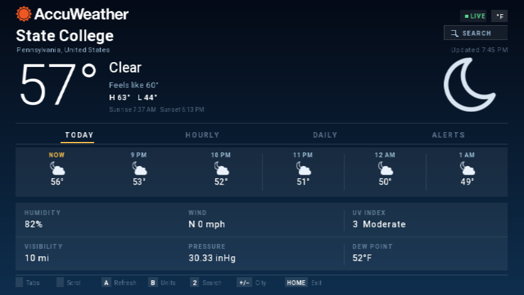

# AccuWeather for Wii

A native Wii port of the AccuWeather Android TV app (v5.3.0), written in C
against libogc/libfat/GX.  It keeps the Android TV layout — the TODAY, HOURLY,
DAILY and ALERTS tabs, the hero panel, the details grid and the real APK
wordmark and fonts — but fetches live weather from the AccuWeather API over
HTTPS instead of using a cached web view.



## Install

Copy the `accuweather-wii` folder to `sd:/apps/` (or `usb:/apps/`) on your
console and launch it from the Homebrew Channel.  The console needs working
Wi-Fi settings; everything else is inside the DOL.

## Controls

| Input | Action |
| --- | --- |
| D-pad left / right | switch tabs |
| D-pad up / down | scroll the hourly strip |
| **A** | refresh |
| **B** | Fahrenheit / Celsius |
| **2** | search for a city (Wii system keyboard) |
| **+ / −** | next / previous bundled city |
| Wii Remote pointer + A | click the tabs, the SEARCH chip and the on-screen keyboard |
| **HOME** | return to the Wii Menu |

Search results come from `/locations/v1/cities/search.json`; the first match is
shown.  Use + / − to go back to the bundled city list (State College is the
default).

## Building

Requires devkitPro with devkitPPC (`C:\devkitPro` in the examples below) and
around 200 MB of free space for the build tree.

```sh
export DEVKITPRO=/opt/devkitpro
export DEVKITPPC=$DEVKITPRO/devkitPPC

bash tools/build_libs.sh   # mbedTLS, libwiiupdate, libwiiosk -> libs/ppc
make -j8                   # accuweather-wii.dol
```

On Windows use `build.ps1`, which sets the toolchain up, builds the third-party
libraries on demand and works around spaces in the project path:

```powershell
.\build.ps1              # build
.\build.ps1 -Libs        # force a rebuild of libs/ppc
.\build.ps1 -Clean       # clean tree first
```

Extra make variables:

| Variable | Purpose |
| --- | --- |
| `AW_API_KEY=...` | use your own AccuWeather developer key instead of the shared one |
| `UI_AUTOCYCLE=1` | cycle the four tabs every 300 frames (screen captures) |
| `UI_BOOTINFO=1` | draw the video mode, latched buttons and a pixel-exact button bit bar |
| `AW_TEST_SEARCH=1` | at start-up, search "Boston" and show the result (end-to-end check of the search API) |

## Layout

```
source/           the app: main loop, GX 2D renderer, FreeType atlas, UI, weather
data/             APK fonts and the wordmark texture, embedded with bin2s
config/           mbedTLS config shared by the app and libs/ppc's libmbedtls.a
libs/libwiiinput  Wii Remote / GameCube / USB keyboard / mouse input layer
libs/libwiiosk    on-screen keyboard (quatric/libwiiosk v2.2.0)
libs/libwiiupdate update checker (quatric/libwiiupdate)
libs/ppc          prebuilt libmbedtls.a, libwiiupdate.a, libwiiosk.a + headers
tools/            build_libs.sh
certs/            CA roots used for HTTPS
```

See `PORT_NOTES.md` for how the port works and what is different from the
Android app.

## Notes

* Unofficial, unaffiliated port.  AccuWeather is a trademark of AccuWeather,
  Inc.  The wordmark, fonts and icon artwork come from the freely distributed
  Android APK and remain the property of their owners.
* Weather data is fetched with the shared AccuWeather key that RiiConnect24's
  File-Maker ships.  It can be replaced at build time with `AW_API_KEY`.
* Rendering is 854×480 logical pixels in 16:9 and 640×480 in 4:3.  In Dolphin,
  set the aspect ratio to **Stretch** for a correct picture.
